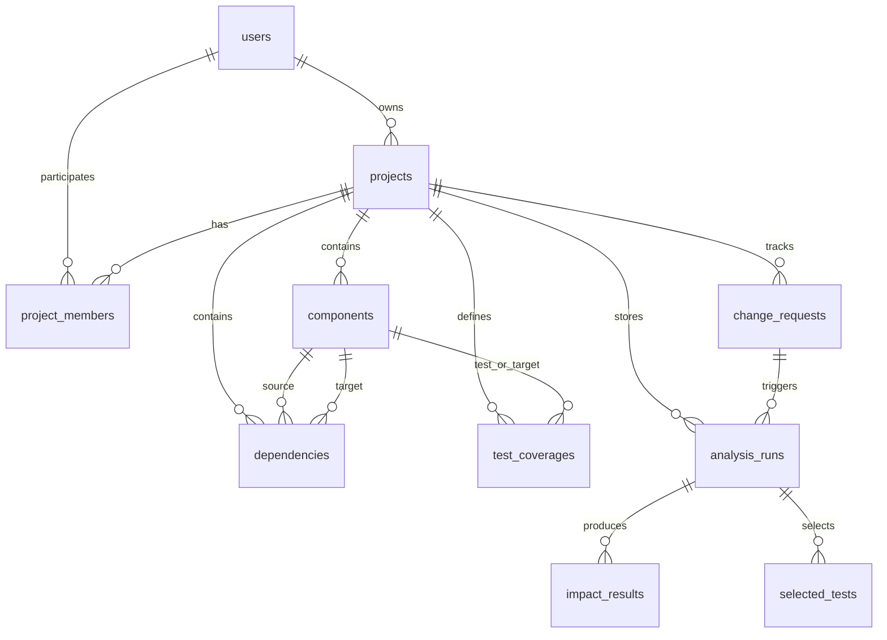

# ChangeRipple Relational Database Schema

Engine: **MySQL 8+ / InnoDB**  
Migration Management: **Flyway** (`classpath:db/migration`)

## 1. Entity-Relationship Overview

## 2. Table Specifications

### 2.1 `users`
Stores user identities and authentication hashes.
- `id`: VARCHAR(36) PRIMARY KEY (UUID)
- `username`: VARCHAR(50) NOT NULL UNIQUE
- `email`: VARCHAR(100) NOT NULL UNIQUE
- `password_hash`: VARCHAR(255) NOT NULL (BCrypt)
- `full_name`: VARCHAR(100) NOT NULL
- `role`: VARCHAR(20) NOT NULL DEFAULT 'USER'
- `created_at`, `updated_at`: TIMESTAMP

### 2.2 `projects`
Provides multi-tenant architectural isolation.
- `id`: VARCHAR(36) PRIMARY KEY
- `name`: VARCHAR(100) NOT NULL
- `description`: TEXT
- `owner_id`: VARCHAR(36) NOT NULL (FK `users.id` ON DELETE CASCADE)

### 2.3 `project_members`
Enforces role-based permissions (`OWNER`, `ADMIN`, `MEMBER`).
- `id`: VARCHAR(36) PRIMARY KEY
- `project_id`: FK `projects.id` ON DELETE CASCADE
- `user_id`: FK `users.id` ON DELETE CASCADE
- `role`: VARCHAR(20) NOT NULL
- UNIQUE KEY `uk_pm_project_user` (`project_id`, `user_id`)

### 2.4 `components`
Nodes representing modules, classes, APIs, tests, and requirements.
- `id`: VARCHAR(36) PRIMARY KEY
- `project_id`: FK `projects.id` ON DELETE CASCADE
- `name`: VARCHAR(100) NOT NULL
- `type`: VARCHAR(20) NOT NULL (`MODULE`, `CLASS`, `API`, `REQUIREMENT`, `TEST`)
- `criticality`: VARCHAR(20) NOT NULL (`LOW`, `MEDIUM`, `HIGH`, `CRITICAL`)
- `source_path`: VARCHAR(255)
- UNIQUE KEY `uk_comp_project_name` (`project_id`, `name`)

### 2.5 `dependencies`
Directed graph edges (`source -> target` means `source depends on target`).
- `id`: VARCHAR(36) PRIMARY KEY
- `project_id`: FK `projects.id` ON DELETE CASCADE
- `source_component_id`: FK `components.id` ON DELETE CASCADE
- `target_component_id`: FK `components.id` ON DELETE CASCADE
- `dependency_type`: VARCHAR(30) NOT NULL DEFAULT 'RUNTIME'
- UNIQUE KEY `uk_dep_edge` (`project_id`, `source_component_id`, `target_component_id`, `dependency_type`)

### 2.6 `test_coverages`
Maps test suites to runtime target components.
- `id`: VARCHAR(36) PRIMARY KEY
- `project_id`: FK `projects.id` ON DELETE CASCADE
- `test_component_id`: FK `components.id` ON DELETE CASCADE
- `target_component_id`: FK `components.id` ON DELETE CASCADE
- `coverage_type`: VARCHAR(30) NOT NULL DEFAULT 'UNIT'
- UNIQUE KEY `uk_test_cov` (`project_id`, `test_component_id`, `target_component_id`)

### 2.7 `change_requests`
Change proposals evaluated by the platform.
- `id`: VARCHAR(36) PRIMARY KEY
- `project_id`: FK `projects.id` ON DELETE CASCADE
- `changed_component_id`: FK `components.id` ON DELETE CASCADE
- `title`: VARCHAR(150) NOT NULL
- `category`: VARCHAR(30) NOT NULL
- `severity`: VARCHAR(20) NOT NULL
- `status`: VARCHAR(20) NOT NULL DEFAULT 'PENDING'
- `author_id`: FK `users.id`

### 2.8 `analysis_runs`
Snapshot of an impact analysis run.
- `id`: VARCHAR(36) PRIMARY KEY
- `change_request_id`: FK `change_requests.id` ON DELETE CASCADE
- `project_id`: FK `projects.id` ON DELETE CASCADE
- `overall_risk_score`: DOUBLE NOT NULL
- `overall_risk_band`: VARCHAR(20) NOT NULL
- `total_affected_components`: INT NOT NULL
- `direct_affected_count`: INT NOT NULL
- `transitive_affected_count`: INT NOT NULL
- `max_impact_depth`: INT NOT NULL
- `candidate_test_count`: INT NOT NULL
- `selected_test_count`: INT NOT NULL
- `test_suite_reduction_percent`: DOUBLE NOT NULL
- `test_coverage_percent`: DOUBLE NOT NULL
- `uncovered_component_count`: INT NOT NULL
- `executed_at`: TIMESTAMP NOT NULL

### 2.9 `impact_results`
Affected component breakdown for an analysis run.
- `id`: VARCHAR(36) PRIMARY KEY
- `analysis_run_id`: FK `analysis_runs.id` ON DELETE CASCADE
- `component_id`: FK `components.id` ON DELETE CASCADE
- `impact_type`: VARCHAR(20) NOT NULL (`DIRECT`, `TRANSITIVE`)
- `depth`: INT NOT NULL
- `shortest_path_json`: TEXT
- `risk_score`: DOUBLE NOT NULL
- `explanation`: TEXT

### 2.10 `selected_tests`
Selected regression tests per strategy.
- `id`: VARCHAR(36) PRIMARY KEY
- `analysis_run_id`: FK `analysis_runs.id` ON DELETE CASCADE
- `test_component_id`: FK `components.id` ON DELETE CASCADE
- `selection_strategy`: VARCHAR(30) NOT NULL (`BASIC`, `GREEDY`)
- `selection_rank`: INT NOT NULL
- `covered_components_json`: TEXT
- `selection_reason`: VARCHAR(255)
